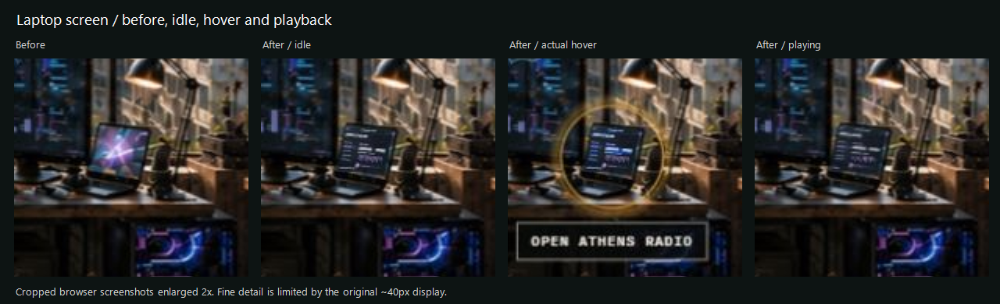
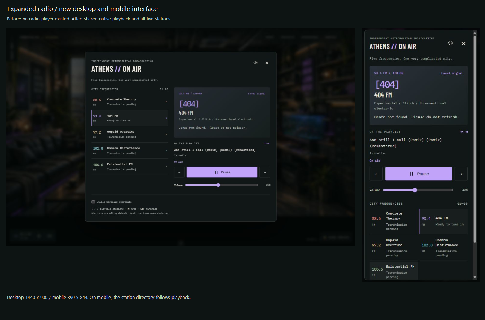
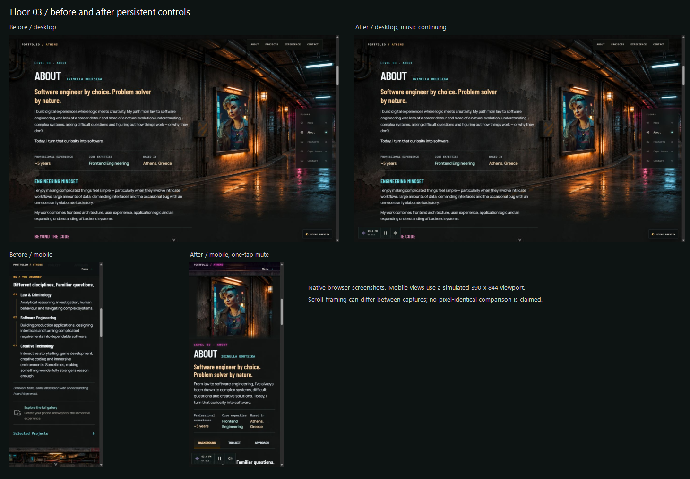

# Radio implementation and verification

Implementation reviewed locally on 2026-11-27. No dependencies were installed.
No artwork was regenerated. Implementation verification preceded staging,
commit, push and deployment; the owner subsequently authorized those release actions.
The pre-existing untracked audit ZIP and `docs/art-production/audits/` were preserved.

## Result

ATHENS // ON AIR has five discoverable station identities, one shared native
audio controller, a miniature laptop website, a telescope-family hotspot,
playback notes, responsive modal and persistent one-tap mute/pause controls.
The supplied original MP3 is copied byte-for-byte and provisionally categorized
under 404 FM with configurable artist credit Irinella. Four stations intentionally
remain off air until songs are supplied. See [radio.md](radio.md) for curation,
state architecture, keyboard behavior and source preservation details.

## Files created and modified

Created:

- `src/types/radio.ts`: station, track and state contracts.
- `src/data/radio.ts`: editable track library and ordered station playlists.
- `src/services/radioController.ts`: native audio lifecycle and race handling.
- `src/composables/useRadio.ts`: application provision/injection and shared UI state.
- `src/components/RadioPlayer.vue`: global utility, dialog, keyboard and modal integration.
- `src/components/RadioLaptop.vue`: registered screen, telescope-style target and notes.
- `src/components/RadioIcon.vue`: small shared SVG utility symbols.
- `src/radio.css`: station/player/utility/laptop presentation and reduced motion.
- `scripts/radio.test.mjs`: 12 controller/manifest regression tests.
- `public/audio/radio/404-fm/And still I call (Remix) (Remix) (Remastered).mp3`.
- `docs/radio.md`, this report and `tmp/radio-review/` captures/evidence/comparison script.

Modified:

- `src/components/AppShell.vue`: own the application radio and mount its UI.
- `src/sections/OfficeHero.vue`: laptop overlay, mobile action, avoid conflicting
  immersive-studio focus trapping while the radio dialog is open.
- `src/hero-scene.css`: exclude phone layouts from the closed desktop intro height rule.
- `package.json`: include radio logic tests in the existing Node test command.

## Checks actually performed

| Check | Result and scope |
| --- | --- |
| Node | PASS: 22.13.1 from the existing local runtime; global Node selection unchanged |
| `npm test` | PASS: 44 tests, 0 failures, including 12 radio tests |
| Separate `vue-tsc --noEmit` | PASS |
| Production build | PASS; existing >500kB JavaScript chunk warning remains |
| `npm run preview` | PASS: production startup is silent, real playback persists across all five floors with exactly one media element; no dev Scene preview control ships |
| `git diff --check` | PASS; Git prints existing LF/CRLF normalization advisories |
| Original audio integrity | PASS: SHA-256 matches the runtime copy, 7,713,147 bytes |
| Silent startup and reload | PASS: no radio media element before Play; opening the dialog stays silent; stored station/volume restore without starting audio |
| Real MP3 playback | PASS: native readyState 4, paused false, increasing playback time and duration 338.8 seconds observed through the rendered media element |
| Play/pause | PASS: native paused true after Pause; resume works without a second media instance |
| Mute/volume | PASS: muting keeps the playback clock running, notes disappear, slider changes status to Playing · muted at zero, one-tap restore works |
| Station discovery | PASS: all five identities, exact taglines and pending states inspected; Play disabled on empty stations |
| Rapid station switching | PASS: browser selection through available/offline stations; controller tests also exercise out-of-order rejected play promises and stale media events |
| Playlist progression and looping | PASS in controller tests with controlled media events, both multiple songs and single-song loops; a full real-time 338.8-second MP3 loop was not observed |
| Cross-floor and player closure | PASS: native playback continues after minimize, scroll and floor navigation; utility remains available |
| Keyboard | PASS: opt-in bracket cycling skips empty stations without starting music, M toggles mute, slider ignores M, Escape closes, Tab wraps and focus returns to laptop/global/mobile opener |
| Missing audio | PASS: temporarily configured missing QA URL produced the retry error with paused media; original URL restored and real playback rechecked |
| Telescope | PASS: opens, zoom changes 1.2× to 1.6×, Escape returns focus, one-tap radio mute works within its focus trap |
| Other discoveries | PASS: chess, aquarium and puzzle book open/close with the same audio state and utility; aquarium initialization caused one browser-input timeout, and the next observation confirmed it opened successfully |
| Laptop hover | PASS: actual pointer hover observed, halo opacity approximately .994 then 1, player stayed closed; keyboard focus also inspected |
| Dialog scroll stability | PASS with native pointer activation: scrollY stayed 0 through open/close. Locator activation scrolls the enclosing SVG before clicking; that automation effect was separated from actual pointer behavior |
| Dialog scene size | PASS after scrollbar-gutter refinement: scene stayed at 1425×801.984px and y=129.008px before, during and after the dialog at desktop size |
| Decorative playback state | PASS: notes absent during mute/pause/zero volume; shared active state controls laptop bars and player visualization |
| Viewport visibility | Implemented: IntersectionObserver and document visibility gate note animation; no forced background-tab timing benchmark performed |
| Desktop | PASS in simulated 1440×900 viewport: idle, hover, day/night playback and expanded player screenshots inspected |
| Tablet | PASS at 768×1024: player fits; no horizontal overflow; original scene coordinates retained |
| Portrait phone | PASS at 390×844 and 320×568: no horizontal dialog overflow, 44px mute target, sticky header survives dialog scrolling, menu entry and focus restoration work |
| Landscape phone | PASS at 844×390 with the existing dev touch-layout gate: cover/contain, laptop entry, radio focus containment and return to portfolio exercised |
| Landscape registration | PASS: screen/map and scene share the same canvas; observed map/scene rectangle differences at most .04px in tested cover/contain views |
| Console | PASS: latest captured warning/error list was empty after exercised flows; this is not dedicated uncaught-exception instrumentation |
| OS reduced-motion emulation | UNVERIFIED: reduced-motion rules reviewed in source; browser tooling did not expose OS media emulation |
| Physical devices, Safari/iOS and real safe areas | UNVERIFIED: browser viewport simulations only |
| Performance | No new renderer, particle system or audio library; no formal CPU/FPS/network benchmark or HAR captured |

The sample is not labelled as genre-verified. Native playback was tested, but no
claim is made about speaker output quality or an independent musical assessment.

## Screenshots

These are native browser captures, not regenerated artwork. Clocks, weather,
cat pose and scroll framing can differ. Day/clear/frozen-parallax Scene preview
was used for the desktop comparison. The before mobile office screenshot also
records the pre-existing closed-intro resize clipping issue corrected in this task.
There was no expanded radio interface before this implementation; its corresponding
before view is the unobstructed original floor, not an invented old player.

Additional full-size captures:

- [Before desktop studio](../tmp/radio-review/before-desktop-day.jpg),
  [after idle](../tmp/radio-review/after-desktop-day-idle.jpg),
  [actual hover](../tmp/radio-review/after-desktop-laptop-hovered.jpg),
  [day playback](../tmp/radio-review/after-desktop-laptop-playing-day.jpg),
  [night playback](../tmp/radio-review/after-desktop-laptop-playing-night.jpg).
- [Before mobile studio](../tmp/radio-review/before-mobile-office.jpg),
  [after mobile studio](../tmp/radio-review/after-mobile-office.jpg),
  [mobile player](../tmp/radio-review/after-mobile-player.jpg),
  [small phone player](../tmp/radio-review/after-mobile-320-player.jpg),
  [mobile offline station](../tmp/radio-review/after-mobile-offline.jpg).
- [Tablet player](../tmp/radio-review/after-tablet-player.jpg),
  [landscape studio](../tmp/radio-review/after-landscape-studio.jpg),
  [landscape player](../tmp/radio-review/after-landscape-player.jpg),
  [contained studio](../tmp/radio-review/after-landscape-contained.jpg).
- [Concrete Therapy](../tmp/radio-review/after-station-concrete.jpg),
  [Unpaid Overtime](../tmp/radio-review/after-station-overtime.jpg),
  [Common Disturbance](../tmp/radio-review/after-station-disturbance.jpg),
  [Existential FM](../tmp/radio-review/after-station-existential.jpg),
  [404 FM](../tmp/radio-review/after-desktop-player-playing.jpg).
- [Missing-source error](../tmp/radio-review/after-mobile-error.jpg),
  [native chess dialog utility](../tmp/radio-review/after-desktop-chess-mute-control.jpg),
  [raw browser observations](../tmp/radio-review/browser-evidence.json).
- [Production observations](../tmp/radio-review/production-evidence.json),
  [pointer versus locator scroll measurements](../tmp/radio-review/scroll-stability.json).

## Visual and technical limits

The artwork's laptop display is roughly 40 native pixels wide. Its miniature
website is convincing at the scene's intended scale, but its text cannot remain
readable when enlarged or reduced to tablet size. The close-up comparison is
explicitly enlarged and shows that limit. The plane uses an affine fit to the
existing four edges, rather than a separately rendered replacement screen asset.
Day/night baked detail and bezel positions differ slightly; the shared overlay
is visually close at normal scene scale, not a claim of perfect pixel registration
under arbitrary enlargement. No whole-background edit or isolated masking asset
is needed for the present scale. A future larger close-up would benefit from an
owner-approved higher-resolution isolated laptop/screen reference and four-corner
registration, without replacing the hero.

The portrait artwork is intentionally unchanged; its laptop content is not
replaced or given an estimated hit area. Visitors use the mobile discovery menu
or global control. Small phone dialogs scroll to retain all station personalities.
The persistent utility is deliberately compact and still overlays a small piece
of content while scrolling, like the existing fixed utilities; it does not reserve
a permanent music bar in any floor.

Only one playable song is supplied. Multi-song progression and competing playable
stations are covered with controlled test media, not several real MP3 files.
Future songs should be spot-checked in a real browser, especially on Safari/iOS.
The current build retains the repository's large JavaScript-chunk warning.

Creative review remains with the owner: approve the laptop treatment, restrained
station signatures/colors, note density and provisional categorization. No further
permission is required for ordinary song configuration; no future broadcasts,
presenters, jingles, advertisements or backend were introduced.
